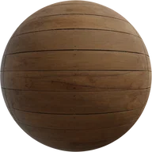
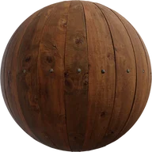
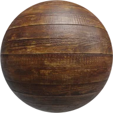
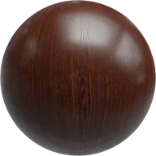
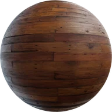
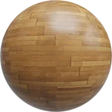
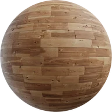
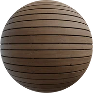
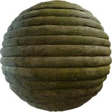
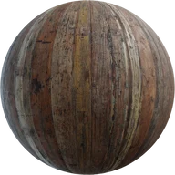

# Poly Haven: Wood textures

**18 assets from [Poly Haven](https://polyhaven.com), dedicated to the public domain under [CC0](https://polyhaven.com/license).** Use them in any game, free or paid, and change them however you like; no credit is needed.

PBR textures as 1K and 2K JPG maps (colour, normal (GL and DX), roughness, AO, displacement and more). 320.5 MB in all.

This is a copy kept by [zuujis-cc0](https://github.com/zuujis-cc0) so game makers can take single files from GitHub. It is not made by or affiliated with Poly Haven: the originals, often in more formats and higher resolutions, are on [polyhaven.com](https://polyhaven.com). If they help you, consider [supporting Poly Haven](https://www.patreon.com/polyhaven/overview).

Every file is listed in [MANIFEST.tsv](MANIFEST.tsv) with its size and SHA-256. More free assets: [the Zuujis collection](https://github.com/zuujis-cc0/free-game-assets#readme).

| | | | |
| :-: | :-: | :-: | :-: |
|  <b><a href="wood_planks">Wood Planks</a></b> by Amal Kumar · <a href="https://polyhaven.com/a/wood_planks">source</a> |  <b><a href="wood_planks_dirt">Wood Planks Dirt</a></b> by Rob Tuytel · <a href="https://polyhaven.com/a/wood_planks_dirt">source</a> |  <b><a href="wood_planks_grey">Wood Planks Grey</a></b> by Rob Tuytel · <a href="https://polyhaven.com/a/wood_planks_grey">source</a> |  <b><a href="wood_shutter">Wood Shutter</a></b> by Dimitrios Savva · <a href="https://polyhaven.com/a/wood_shutter">source</a> |
|  <b><a href="wood_table">Wood Table</a></b> by Dimitrios Savva · <a href="https://polyhaven.com/a/wood_table">source</a> |  <b><a href="wood_table_001">Wood Table 001</a></b> by Dimitrios Savva, Rico Cilliers · <a href="https://polyhaven.com/a/wood_table_001">source</a> |  <b><a href="wood_table_large">Wood Table Large</a></b> by Dimitrios Savva · <a href="https://polyhaven.com/a/wood_table_large">source</a> |  <b><a href="wood_table_worn">Wood Table Worn</a></b> by Dimitrios Savva, Rico Cilliers · <a href="https://polyhaven.com/a/wood_table_worn">source</a> |
|  <b><a href="wood_trunk_wall">Wood Trunk Wall</a></b> by Amal Kumar · <a href="https://polyhaven.com/a/wood_trunk_wall">source</a> |  <b><a href="wooden_barrel">Wooden Barrel</a></b> by Dimitrios Savva · <a href="https://polyhaven.com/a/wooden_barrel">source</a> |  <b><a href="wooden_floor_01">Wooden Floor 01</a></b> by Charlotte Baglioni, Rico Cilliers · <a href="https://polyhaven.com/a/wooden_floor_01">source</a> |  <b><a href="wooden_floor_02">Wooden Floor 02</a></b> by Charlotte Baglioni, Rico Cilliers · <a href="https://polyhaven.com/a/wooden_floor_02">source</a> |
|  <b><a href="wooden_garage_door">Wooden Garage Door</a></b> by Dimitrios Savva · <a href="https://polyhaven.com/a/wooden_garage_door">source</a> |  <b><a href="wooden_gate">Wooden Gate</a></b> by Amal Kumar · <a href="https://polyhaven.com/a/wooden_gate">source</a> |  <b><a href="wooden_panels">Wooden Panels</a></b> by Dimitrios Savva · <a href="https://polyhaven.com/a/wooden_panels">source</a> |  <b><a href="wooden_planks">Wooden Planks</a></b> by Charlotte Baglioni, Dario Barresi · <a href="https://polyhaven.com/a/wooden_planks">source</a> |
|  <b><a href="wooden_rough_planks">Wooden Rough Planks</a></b> by Rob Tuytel · <a href="https://polyhaven.com/a/wooden_rough_planks">source</a> |  <b><a href="worn_planks">Worn Planks</a></b> by Dimitrios Savva · <a href="https://polyhaven.com/a/worn_planks">source</a> |  |  |

---

Kept up to date by this repository's own [update workflow](.github/workflows/update.yml), with code and plan from [cc0-mirror](https://github.com/zuujis-cc0/cc0-mirror). Something wrong? [Open an issue there](https://github.com/zuujis-cc0/cc0-mirror/issues/new) or use the [private report form](https://games.zuujis.com/report).
